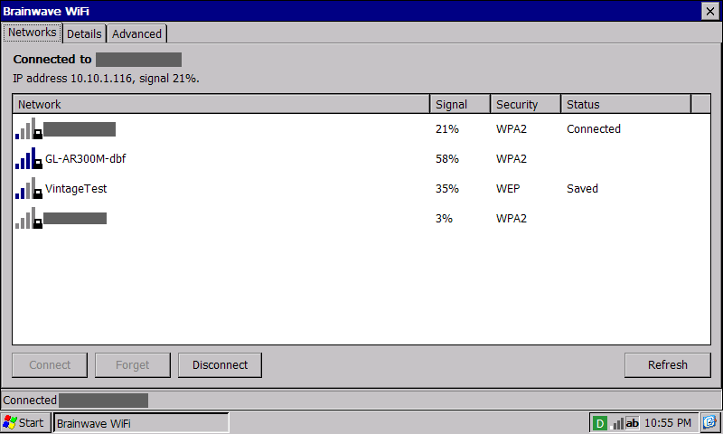
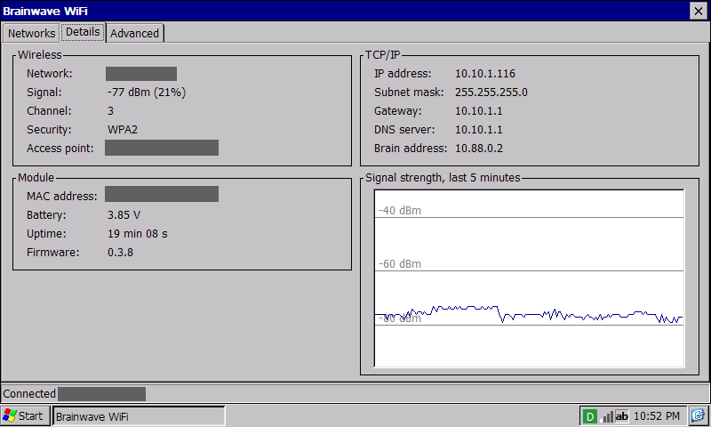
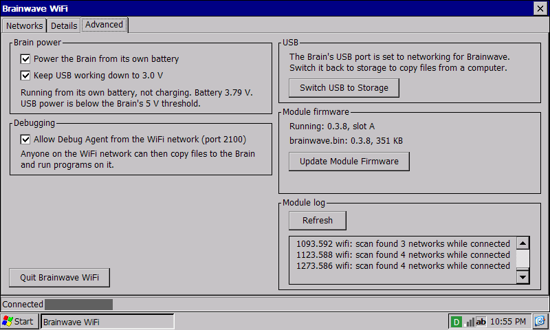

# Brainwave

A USB WiFi module for the SHARP Brain (PW-SH1, PW-SH2) running Windows CE from a pwsh2-boot card: our U-Boot loader and patched CE with the brainshell desktop, not yet published. The Brain's ROM has no USB host stack, so Brainwave is the host: the Brain runs RNDIS, and Brainwave gives it an address by DHCP, relays DNS and shares its WiFi connection. The Brainwave WiFi app on the Brain picks networks and updates the module's firmware over the same link.



| Details | Advanced |
| --- | --- |
|  |  |

## Bill of Materials

| Part | Notes |
| --- | --- |
| [Pimoroni Pico LiPo 2 XL W](https://shop.pimoroni.com/products/pimoroni-pico-lipo-2-xl-w?variant=55447911006587) | RP2350B, CYW43439, 16 MB flash |
| LiPo battery with a JST-PH connector | Powers Brainwave and, through VBUS, the Brain's USB port |
| 2-pin female header | Soldered into VBUS and VSYS |
| A short piece of solid core wire | Bridges VBUS to VSYS in that header |
| USB-C to Micro-B cable | From Brainwave's USB-C port to the Brain |

The Brain only sees a cable when there is voltage on VBUS, and the Pico LiPo 2 XL W does not put its battery on its USB-C port. Bridge VBUS to VSYS with the wire, **only while Brainwave is used with the Brain**.

**Remove the wire before plugging Brainwave into a computer, charger or anything else that supplies USB power.** With the bridge in place, that 5 V goes straight onto VSYS and the battery side of the board, bypassing its power path. That will probably damage the board, the battery or the other device's port.

## Building and Flashing

```sh
git submodule update --init
git -C firmware/pico-sdk submodule update --init lib/cyw43-driver lib/lwip
make test ce firmware
```

Needs `arm-none-eabi-gcc`, CMake, Ninja, Python 3, Node and [jornada-72x-tools](https://github.com/Gadgetoid/jornada-72x-tools) (set `JORNADA_TOOLCHAIN` to its path).

First flash, wire out, holding BOOT while plugging in:

```sh
make partitions
picotool load build/firmware/partitions.uf2
picotool reboot -u
picotool load -p 0 -x build/firmware/brainwave.uf2
```

After that, copy `build/firmware/brainwave.bin` next to the app on the card and use Update Module Firmware in the app, or run `make push MODULE=10.88.0.1`. Updates go into the other of two flash slots and are kept after 30 s of running; a hang or crash before then puts the previous firmware back.

On the card, `brainwave\` holds `brainwave.exe` and `bwpower.dll` from `build/ce/`, and optionally `brainwave.bin`. The Brain also needs `rndisfn.dll`, the RNDIS function driver from NXP's i.MX28 Windows CE EVK image, next to the app or in `\Windows`. It is not redistributable, so it is not included here.

Releases (`brainwave-VERSION.zip`, built by CI from a `v*` tag) hold `card/brainwave/` ready to copy to the card and `firmware/` with both UF2s for the first flash.

More: [docs/protocol.md](docs/protocol.md) (control protocol), [docs/hardware.md](docs/hardware.md) (power, USB and debugging), [ce/ReadMe.txt](ce/ReadMe.txt) (user guide).

## Licence

MIT, see [LICENSE](LICENSE).
